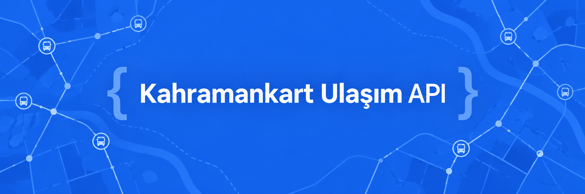

# Kahramankart Ulaşım API


[](LICENSE)

Kahramanmaraş otobüs hatları, durakları, canlı araç konumları ve sefer saatleri için sade bir JSON API'si. Python ve FastAPI ile yazıldı. [Maraş Ulaşım](https://github.com/uzaylikafasi/maras-ulasim) Android uygulaması bu API'yi kullanır.

**[API dokümanı](https://mithrixa.com/ulasim-api/docs)** · [OpenAPI şeması](https://mithrixa.com/ulasim-api/openapi.json) · [Android uygulamasının reposu](https://github.com/uzaylikafasi/maras-ulasim)

> Resmî bir hizmet değildir. Belediye veya Kahramankart ile bağlantısı yoktur. Veriler kaynağın verdiği gibidir; varış süreleri tahmindir.

**İçindekiler:** [Hızlı deneme](#hızlı-deneme) · [Uçlar](#uçlar) · [Kurulum](#kendi-sunucunda-çalıştırma) · [Dosyalar](#dosyalar) · [Lisans](#lisans)

## Hızlı deneme

Hazır sunucu: `https://mithrixa.com/ulasim-api`

```sh
curl 'https://mithrixa.com/ulasim-api/v1/search?q=H/1'
curl 'https://mithrixa.com/ulasim-api/v1/lines/9576/vehicles?direction=1'
```

| Kullanım | Sınır |
| --- | --- |
| Erişim anahtarı | Hazır sunucuda gerekmez |
| İstek sayısı | IP başına dakikada en fazla 90 istek |
| Canlı araç verisi | 15 saniyeden sık sorgulamayın |

## Uçlar

| Yol | Açıklama |
| --- | --- |
| `/v1/search?q=` | Hat, durak ve adres araması |
| `/v1/stops/nearby?latitude=&longitude=` | Yakındaki duraklar |
| `/v1/stops/in-bounds?south=&west=&north=&east=` | Harita alanındaki duraklar |
| `/v1/stops/{id}` | Durak ve yaklaşan otobüsler |
| `/v1/stops/{id}/lines` | Duraktan geçen hatlar |
| `/v1/lines/{id}/vehicles?direction=` | Hattaki araçların canlı konumu |
| `/v1/lines/{id}/stops?direction=` | Hattın durakları |
| `/v1/lines/{id}/shape?direction=&format=geojson` | Güzergâh çizgisi |
| `/v1/timetables?line_code=` | Sefer saatleri |
| `/v1/announcements` | Duyurular |
| `/v1/journeys?from_stop_id=&to_stop_id=` | İki durak arası yolculuk önerisi |
| `/healthz` | Sunucunun çalışıp çalışmadığı |

Tam liste ve alanlar için [API dokümanına](https://mithrixa.com/ulasim-api/docs) bakın.

> Boş araç listesi, "şu an veri yok" demektir; konum uydurulmaz.

## Kendi sunucunda çalıştırma

**Gereksinim:** Python 3.11+

```sh
cp .env.example .env
# .env dosyasındaki ayarları düzenleyin.
./run.sh
```

`run.sh`, `.venv` yoksa oluşturup bağımlılıkları kurar ve sunucuyu varsayılan olarak `http://127.0.0.1:8000` adresinde başlatır. Yerel etkileşimli doküman: [http://127.0.0.1:8000/docs](http://127.0.0.1:8000/docs).

### Kaynak servise erişim

Kaynak servise erişim bilgisi depoda yoktur. `.env` dosyasında aşağıdaki iki ayardan biriyle verilir; istemci koduna veya tarayıcıya gönderilmez.

| Değişken | Değer |
| --- | --- |
| `PALLIUM_AUTH_FILE` | Erişim bilgisini içeren yerel JSON dosyasının yolu |
| `PALLIUM_AUTHORIZATION` | Tam başlık değeri |

### İsteğe bağlı ayarlar

| Değişken | Açıklama |
| --- | --- |
| `API_HOST`, `API_PORT` | Dinlenecek adres ve port. Başka cihazlardan erişim için `API_HOST=0.0.0.0` |
| `API_ACCESS_KEY` | Ayarlanırsa `/v1` çağrıları `X-API-Key` başlığı ister |
| `CORS_ORIGINS` | Tarayıcıdan erişebilecek siteler |

## Dosyalar

| Yol | İçerik |
| --- | --- |
| [transport_api/](transport_api/) | FastAPI sunucusu ve kaynak servis adaptörü |
| [deployment/](deployment/) | Herkese açık köprü (`transport_proxy.py`: yalnız GET, IP başına sınır), doküman sayfası ve systemd örneği |
| [examples/client.mjs](examples/client.mjs) | JavaScript istemci örneği |
| [tools/](tools/) | Durak listesi üretme betikleri |
| [tests/](tests/) | Testler: `pytest` ve `node --test tests/client.test.mjs` |

## Lisans

[MIT](LICENSE)
